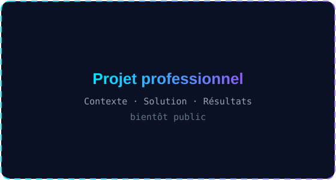

  

  
  
  
  

  

## ◢ À propos

Développeur autodidacte, je conçois des **systèmes d'IA autonomes** et des **produits logiciels** pensés pour être utilisés au quotidien : automatisation, supervision, outils pour les équipes et les créateurs.

Ce que je recherche dans chaque projet :

| | |
|---|---|
| 🎯 **Utilité** | Résoudre un vrai problème, pas empiler des fonctionnalités. |
| 🔒 **Confidentialité** | Les données de chaque client restent privées et cloisonnées. |
| ⚙️ **Fiabilité** | Un code lisible, testé, qui tient dans la durée. |
| 💸 **Sobriété** | Maîtriser les coûts (tokens, ressources) dès la conception. |

## ◢ Compétences

<table>
<tr>
<td width="33%" valign="top">

**Langages**

</td>
<td width="33%" valign="top">

**IA & automatisation**

</td>
<td width="33%" valign="top">

**Produit & outils**

</td>
</tr>
</table>

## ◢ Projets

### Projet principal — en cours de développement

> **Agentopia** — plateforme SaaS d'agents IA : agents spécialisés par entreprise, optimisation automatique de la consommation de tokens, données privées par client, formules d'abonnement.
> *Développement privé — démonstration publique à venir.*

### Projets publics

<table>
<tr>
<td width="50%" align="center">

 🤖 Bot d'automatisation
</td>
<td width="50%" align="center">

 👁️ Supervision et surveillance
</td>
</tr>
<tr>
<td width="50%" align="center">

 🌐 Site web
</td>
<td width="50%" align="center">

 🎮 Jeux
</td>
</tr>
</table>

### Projets professionnels à venir

  
  

## ◢ Activité

  
  

## ◢ Feuille de route

- [x] Premiers bots et outils publics
- [x] Agentopia : agents, optimisation des tokens, parrainage, analyste d'entreprise
- [ ] Agentopia : ouverture de la version publique
- [ ] Publication de projets professionnels détaillés ici
- [ ] Études de cas : problème, solution, résultats

## ◢ Contact

  
  

Coder pour progresser — et pour le plaisir.

