  

  
  
  

<b>Agents IA utiles et fiables · Produits SaaS pensés pour la confidentialité · De l'idée au produit déployé</b>

## ◢ À propos

Développeur autodidacte, je conçois des **systèmes d'IA autonomes** et des **produits logiciels** pensés pour être utilisés au quotidien : automatisation, supervision, outils pour les équipes et les créateurs.

Ce que je recherche dans chaque projet :

| | |
|---|---|
| 🎯 **Utilité** | Résoudre un vrai problème, pas empiler des fonctionnalités. |
| 🔒 **Confidentialité** | Les données de chaque client restent privées et cloisonnées. |
| ⚙️ **Fiabilité** | Un code lisible, testé, qui tient dans la durée. |
| 💸 **Sobriété** | Maîtriser les coûts (tokens, ressources) dès la conception. |

## ◢ Compétences

<table>
<tr>
<td width="33%" valign="top">

**Langages**

</td>
<td width="33%" valign="top">

**IA & automatisation**

</td>
<td width="33%" valign="top">

**Produit & outils**

</td>
</tr>
</table>

## ◢ Contact

  
  

Coder pour progresser — et pour le plaisir.

